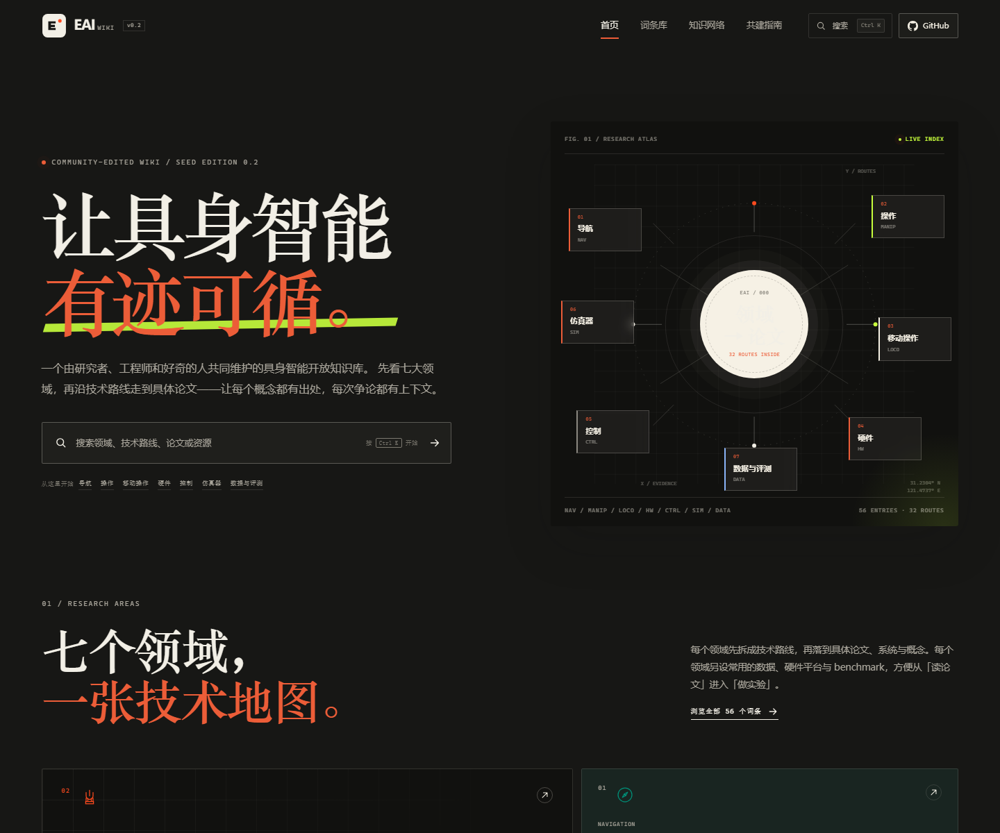
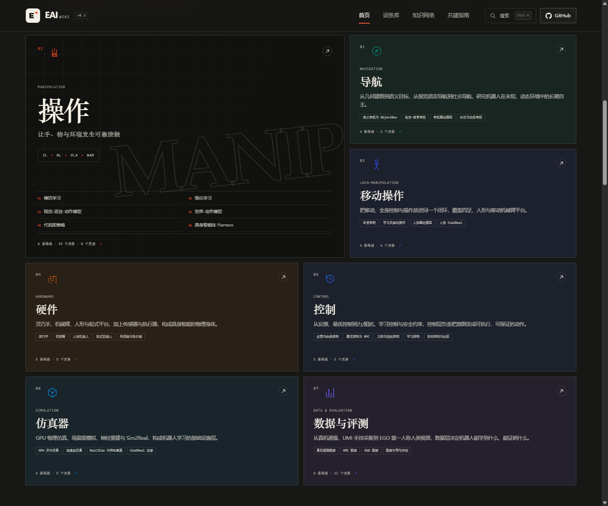
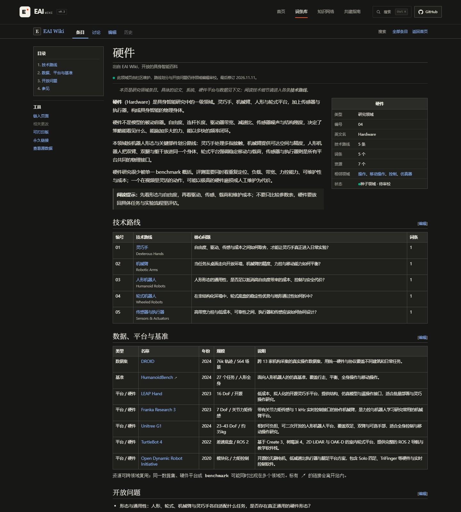
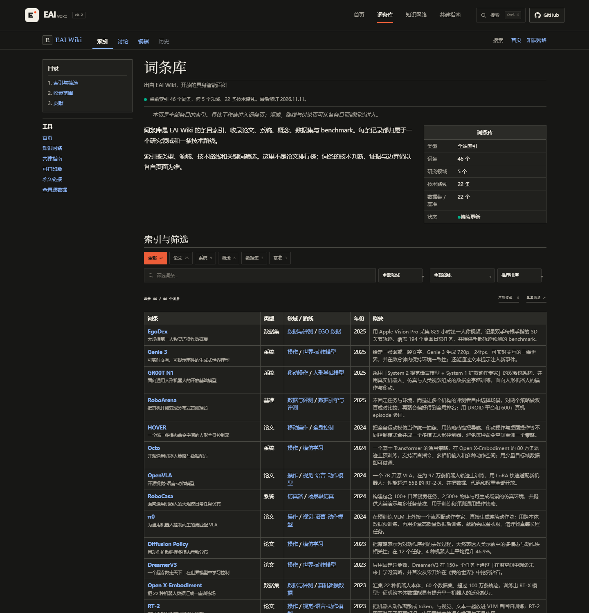
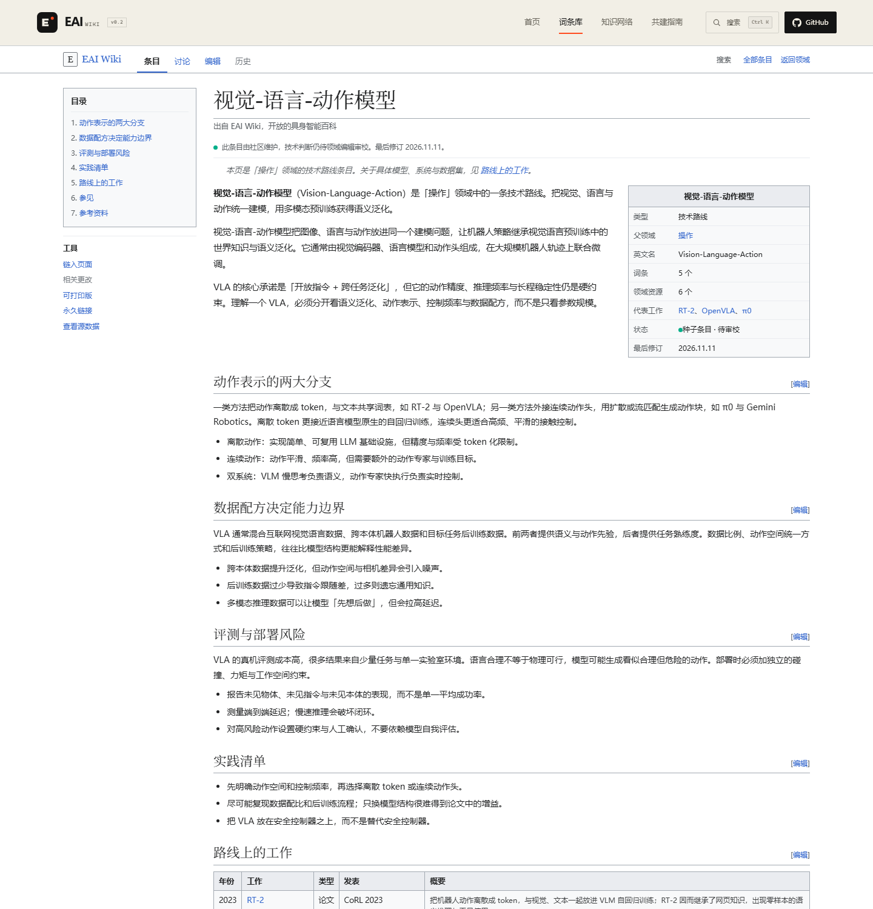
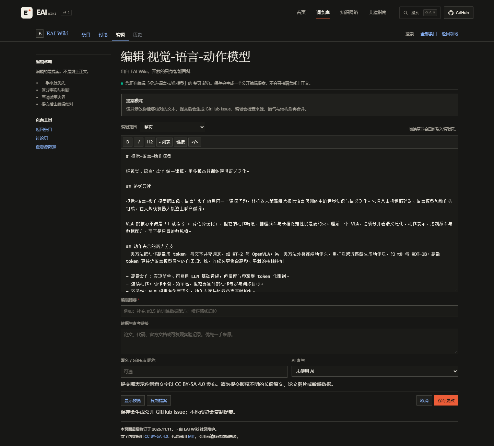
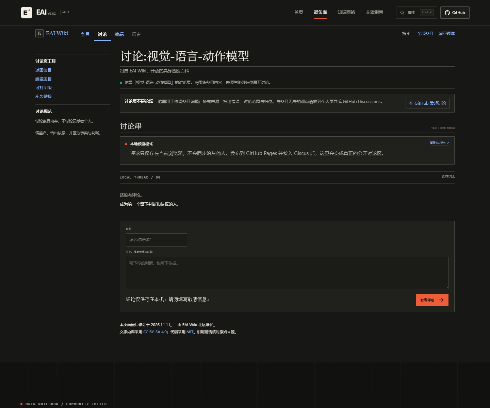
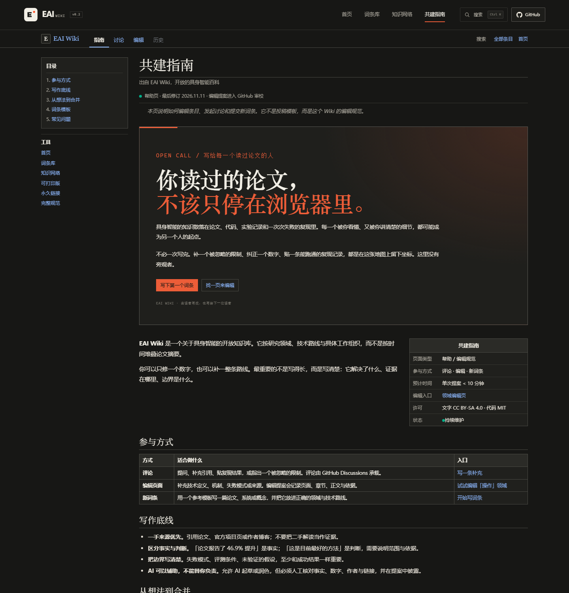

# EAI Wiki · 具身智能开放知识库

一个可直接发布到 GitHub Pages 的具身智能 Wiki。它不是平铺的论文列表，而是一张**领域 → 技术路线 → 具体工作 → 数据/平台/基准**的分层地图。

- **7 个研究领域**：导航、操作、移动操作、硬件、控制、仿真器、数据与评测
- **32 条技术路线**：如操作领域下的模仿学习、强化学习、VLA、WAM、代码即策略、具身智能体 Harness
- **56 个深度词条**：论文 / 系统 / 概念 / 数据集 / 基准
- **28 个常用数据集、硬件平台与基准**：按领域交叉收录，可直接跳转站内词条或原始项目页
- **公开讨论**：Giscus + GitHub Discussions
- **维基式详情页**：条目 / 讨论 / 编辑 / 历史标签、左侧目录、信息框、带 [编辑] 的章节、参考来源与页面分类
- **Wiki 编辑提案**：顶部「编辑」标签与章节「[编辑]」都会生成公开 GitHub Issue
- **社区共建**：附带 Issue Forms、PR 模板与编辑规范
- **零构建、零依赖**：原生 HTML / CSS / JavaScript，推送即可部署



首页只保留 hero、七个领域卡片与底部贡献 CTA，不再堆叠精选、阅读路径、知识网络和主题云。七个领域是导航、操作、移动操作、硬件、控制、仿真器、数据与评测；硬件领域继续按灵巧手、机械臂、人形机器人、轮式机器人、传感器与执行器拆分。



硬件领域页把五条路线、对应词条与具体平台放进同一张 Wiki 表格：



词条库也是 Wiki 索引页：左侧目录、筛选工具、类型与领域表格、条目的讨论 / 编辑标签，而不是卡片瀑布流。



领域、路线和词条详情页都采用维基百科式的文章版式：**条目 / 讨论 / 编辑 / 历史**命名空间标签、左侧目录、右侧信息框、带 `[编辑]` 的章节、wikitable、编号参考资料、页面分类和最后修订信息。编辑与讨论不是弹窗，而是独立的编辑页和 `讨论:` 讨论页。



编辑页参考维基百科的编辑界面：章节选择、Markdown 工具条、实时预览、编辑摘要、来源与 AI 披露。



讨论页是独立的 `讨论:` 命名空间，而不是文章底部的评论区；每个页面都有独立的讨论串。



共建指南也改成 Wiki 帮助页，保留编辑规范、模板与常见问题。



---

## 知识结构

```text
Research Area
└── Technical Route
    ├── Papers / Systems / Concepts
    └── Related Datasets, Platforms & Benchmarks
```

| 研究领域 | 技术路线 |
| --- | --- |
| 导航 Navigation | 语义导航与 ObjectNav、视觉-语言导航、导航基础模型、社交与动态导航 |
| 操作 Manipulation | 模仿学习、强化学习、视觉-语言-动作模型（VLA）、世界-动作模型（WAM）、代码即策略、具身智能体 Harness |
| 移动操作 Loco-Manipulation | 全身控制、学习式移动操作、人形基础模型、人形 Sim2Real |
| 硬件 Hardware | 灵巧手、机械臂、人形机器人、轮式机器人、传感器与执行器 |
| 控制 Control | 反馈与经典控制、最优控制与 MPC、力控与阻抗控制、学习控制、安全控制与约束 |
| 仿真器 Simulation | GPU 并行仿真、场景级仿真、Real2Sim 与神经重建、Sim2Real 迁移 |
| 数据与评测 Data & Evaluation | 真机遥操数据、UMI 数据、EGO 数据、数据引擎与评测（横切基础设施） |

每个领域页同时提供：

- 领域导读与核心问题
- 技术路线目录及每条路线的代表工作
- 常用 **datasets**、**benchmarks** 与硬件平台
- 相邻领域与顶部「编辑」入口

每条技术路线有独立页面（`#/route/<domain>/<route>`），不是简单的论文列表，而是一篇持续维护的 Wiki 条目：

- **技术导读**：定义问题、系统边界与这条路线为什么存在
- **技术拆解**：方法谱系、关键设计、权衡与失效模式
- **实践清单**：部署与实验时真正需要检查的事项
- **路线工作**：按时间排列的具体论文、系统与数据集
- **参考来源 / Infobox / 目录**：可跳转的一手来源与结构化元数据
- **章节级编辑提案**：每个小节都能单独补充或修订，提交到 GitHub 审核

数据领域按**采集接口**而不是「跨本体」划分：真机遥操、UMI 手持采集、EGO 第一人称人类视频，再加上跨路线共用的数据引擎与评测。DROID / Open X-Embodiment 作为真机遥操数据收录，跨机构、跨本体是它们的属性，而不是单独的数据来源。

---

## 本地预览

```bash
# 任选一种
node scripts/serve.mjs 4173
# 打开 http://127.0.0.1:4173

# 或
python -m http.server 4173
```

站点没有构建步骤。直接双击 `index.html` 也能打开大部分功能，但本地评论、剪贴板等能力在不同浏览器下可能受限，建议用本地服务器预览。

---

## 发布到 GitHub Pages

### 1. 创建仓库并推送

```bash
git init
git add .
git commit -m "feat: seed EAI Wiki"
git branch -M main
git remote add origin https://github.com/<your-name>/eai-wiki.git
git push -u origin main
```

> GitHub Pages 对公开仓库免费；私有仓库需要符合 GitHub 当前的 Pages 套餐要求。

### 2. 启用 Pages

在仓库 **Settings → Pages → Build and deployment** 中把 Source 设为 **GitHub Actions**。

仓库已包含 [`.github/workflows/pages.yml`](.github/workflows/pages.yml)，推送到 `main` 后会自动部署。站点地址通常为：

```text
https://<your-name>.github.io/eai-wiki/
```

如果仓库名本身就是 `<your-name>.github.io`，地址为 `https://<your-name>.github.io/`。

部署完成后，建议把 `index.html` 中的 `og:image` 改成完整绝对地址（例如 `https://<your-name>.github.io/eai-wiki/assets/img/og-cover.png`），这样社交平台才能正确抓取分享封面。

### 3. 配置仓库地址（通常不用改）

站点会自动从 `*.github.io` 地址推断 `owner/repo`。使用默认 GitHub Pages 域名时，`assets/js/config.js` 里的 `repo` 可以留空。

只有以下情况需要手动填写：

```js
window.EAI_CONFIG = {
  repo: "your-name/eai-wiki",
  // ...
};
```

- 使用自定义域名
- 在非 GitHub Pages 环境下部署
- 自动推断结果不符合实际仓库

填写后，页头 GitHub 链接、Issue 表单、编辑入口和 Discussions 链接都会指向该仓库。

### 4. 接入公开评论（推荐，约 3 分钟）

本地预览里的评论只保存在当前浏览器。要让所有访客共享讨论，需要配置 Giscus：

1. 开启仓库 Discussions，并安装 [giscus GitHub App](https://github.com/apps/giscus)。
2. 创建一个 **Announcements** 类型的分类（推荐名 `Announcements`）。
3. 按 [`GISCUS_SETUP.md`](GISCUS_SETUP.md) 获取 `repoId` 与 `categoryId`。
4. 填入 `assets/js/config.js`：

```js
comments: {
  repoId: "R_kgDO...",
  category: "Announcements",
  categoryId: "DIC_kwDO...",
  // ...
}
```

领域页、路线页、词条页都使用独立的 discussion term，例如 `eai-wiki/entry/openvla`、`eai-wiki/route/manipulation/vla`、`eai-wiki/domain/data`。

---

## 编辑内容

全部内容在 [`assets/js/data.js`](assets/js/data.js)，核心导出：

| 导出 | 用途 |
| --- | --- |
| `DOMAINS` | 7 个领域、领域内技术路线、领域导读 |
| `ROUTE_DETAILS` | 每条路线的 Wiki 正文：技术导读、技术拆解、实践清单 |
| `DOMAIN_DETAILS` | 每个领域的开放问题与阅读提示 |
| `ENTRIES` | 词条，使用 `domain` + `route` 两级归属 |
| `RESOURCES` | 每个领域的数据集、benchmark 与硬件平台，可引用站内词条 |
| `TYPE_LABELS` | 词条类型的中文显示 |

### 领域 → 路线

```js
{
  id: "manipulation",
  name: "操作",
  en: "Manipulation",
  routes: [
    {
      id: "vla",
      name: "视觉-语言-动作模型",
      en: "Vision-Language-Action",
      summary: "把视觉、语言与动作统一建模……",
      question: "语义泛化、动作精度与控制频率之间……",
      tags: ["动作 token", "跨本体", "双系统"]
    }
  ]
}
```

### 词条归属

```js
{
  id: "openvla",
  domain: "manipulation",  // 必须是 DOMAINS 中已有的 id
  route: "vla",            // 必须是该领域 routes 中已有的 id
  type: "paper",           // paper | system | concept | dataset | benchmark
  title: "OpenVLA",
  subtitle: "开源视觉-语言-动作模型",
  year: 2024,
  venue: "CoRL 2024",
  org: "Stanford · UC Berkeley · Google DeepMind 等",
  authors: "Moo Jin Kim, Karl Pertsch 等",
  tags: ["开源", "7B", "跨本体", "LoRA"],
  tldr: "……",
  why: "……",
  intro: ["……", "……"],
  method: [{ title: "……", text: "……" }],
  evidence: [{ value: "+16.5%", label: "……", text: "……" }],
  limits: ["……"],
  related: ["rt2", "octo", "pi0"],
  links: [{ label: "论文", url: "https://arxiv.org/abs/2406.09246" }]
}
```

### 数据集 / benchmark / 硬件平台

```js
{
  id: "res-calvin",
  name: "CALVIN",
  type: "benchmark",              // dataset | benchmark | platform
  year: 2022,
  domains: ["manipulation", "data"],
  scale: "34 个任务 / 长程指令",
  summary: "面向长程语言条件操作的仿真 benchmark……",
  url: "https://github.com/mees/calvin",
  entryId: "optional-entry-id"    // 可选：链接到已有词条
}
```

`RESOURCES` 可以跨领域复用。同一份资源会出现在多个领域页，但只占用一个搜索索引。

### 路线 Wiki 正文

路线页面不是自动生成的摘要。每个 `ROUTE_DETAILS` 条目包含：

```js
"manipulation:vla": {
  lead: [
    "第一段定义问题与技术边界。",
    "第二段说明主要争论、取舍与阅读方法。"
  ],
  sections: [
    {
      title: "动作表示的两大分支",
      body: ["技术解释……"],
      bullets: ["离散动作的取舍……", "连续动作的取舍……"]
    }
  ],
  practice: ["部署前先检查……", "评测时不要……"]
}
```

领域页的开放问题在 `DOMAIN_DETAILS` 中维护：

```js
manipulation: {
  openProblems: ["跨本体的动作表示……", "接触丰富任务……"],
  readingGuide: "先看它解决哪类失败……"
}
```

### 新增路线

在目标领域的 `routes` 数组里追加路线，在 `ROUTE_DETAILS` 中使用 `"<domain>:<route>"` 补齐技术正文，然后在词条中使用新的 `route` id。领域页、路线页、筛选器、搜索与知识网络会自动更新。`validate-content.mjs` 会检查缺失的路线正文。

### 更新版本与日期

修改 `assets/js/config.js` 中的 `version`、`edition`、`updated`。词条页和共建页会显示这些信息。

---

## 贡献与评论

- 领域页、路线页、词条页的顶部「编辑」标签和章节「[编辑]」会打开 Wiki 编辑提案，生成一个**公开 GitHub Issue**，并带上页面、章节、依据与署名。
- 站内「贡献一个词条」表单会生成一个**公开 GitHub Issue**，并带上领域与技术路线。
- 仓库自带三个 Issue Forms：编辑页面、新词条、修订建议。
- 评论通过 Giscus 落到 GitHub Discussions；每个领域、路线与词条页面都有独立讨论串和讨论页。
- 本地预览的评论存在 `localStorage`，明确标记为「仅本机可见」。
- 详细规范见 [`CONTRIBUTING.md`](CONTRIBUTING.md)。

### 审核原则

1. **一手来源优先**：论文、官方项目页、代码、作者博客。
2. **路线归位**：新词条应说明它属于哪条技术路线；如果开新路线，要解释与已有路线的关系。
3. **区分事实与判断**：数字需带评测条件；判断需给依据。
4. **把边界写清楚**：失败模式、未验证假设和 demo 剪辑同样重要。
5. **AI 辅助必须披露**：不得编造引用、作者、数字或评测结论。

---

## 项目结构

```text
eai-wiki/
├── index.html                    # 单页应用外壳 + 静态页头/页脚/弹窗
├── 404.html                      # 静态 404 回退
├── assets/
│   ├── css/styles.css            # 视觉系统、响应式布局、动效
│   ├── js/config.js              # 仓库地址、Giscus、版本
│   ├── js/data.js                # 领域、路线、词条、资源、路径
│   ├── js/app.js                 # 路由、搜索、筛选、图谱、表单、评论
│   └── img/                      # 图标与社交封面
├── .github/
│   ├── workflows/pages.yml       # GitHub Pages 自动部署
│   ├── ISSUE_TEMPLATE/           # 编辑页面 / 新词条 / 修订表单
│   └── pull_request_template.md
├── scripts/
│   ├── serve.mjs                 # 零依赖本地预览服务器
│   ├── validate-content.mjs      # 校验领域/路线/词条/资源引用
│   ├── check-links.mjs           # 检查论文与项目链接
│   └── og-template.html          # 可重新渲染的社交封面模板
├── docs/preview.png              # 首页预览
├── docs/preview-domains.png      # 七个研究领域卡片
├── docs/preview-hardware.png     # 硬件领域 Wiki 页
├── docs/preview-catalog.png      # 词条库索引预览
├── docs/preview-route.png        # 路线 Wiki 预览
├── docs/preview-edit.png         # 编辑页预览
├── docs/preview-talk.png         # 讨论页预览
├── docs/preview-contribute.png   # 共建帮助页预览
├── GISCUS_SETUP.md               # 讨论页 / 评论区接入说明
├── CONTRIBUTING.md               # 编辑与贡献规范
├── LICENSE                       # 代码：MIT
└── LICENSE-CONTENT.md            # 文字：CC BY-SA 4.0
```

### 页面路由

| URL | 页面 |
| --- | --- |
| `#/` | 首页与研究领域地图 |
| `#/entries` | 全部词条；支持类型 / 领域 / 路线筛选 |
| `#/domain/:domainId` | 领域条目：技术路线表、数据 / 平台 / 基准、开放问题 |
| `#/route/:domainId/:routeId` | 路线条目：技术拆解、实践清单与代表工作 |
| `#/entry/:entryId` | 词条条目：技术机制、证据、参考来源与分类 |
| `#/edit/domain/:domainId` | 领域编辑页 |
| `#/edit/route/:domainId/:routeId` | 路线编辑页；支持 `?section=...` |
| `#/edit/entry/:entryId` | 词条编辑页；支持 `?section=...` |
| `#/talk/domain/:domainId` | 领域讨论页 |
| `#/talk/route/:domainId/:routeId` | 路线讨论页 |
| `#/talk/entry/:entryId` | 词条讨论页 |
| `#/graph` | 七领域知识网络 |
| `#/contribute` | 共建指南 |

由于是 hash 路由，GitHub Pages 不需要额外的 rewrite 规则。

---

## 维护工具

不需要安装依赖：

```bash
# 校验领域 → 路线 → 词条 → 资源的完整引用图
node scripts/validate-content.mjs

# 检查论文/项目/数据集链接是否可达（需要联网）
node scripts/check-links.mjs
```

修改 `scripts/og-template.html` 后，用任意 1200×630 视口截图覆盖 `assets/img/og-cover.png`。GitHub Actions 只部署站点运行所需文件，不会把测试资料发布到线上。

---

## 设计说明

- **深色 Wiki 视觉**：全站采用炭黑背景（`#171715`）、米白文字与橙色强调。配色层不改变文章页与首页布局；**词条库与共建指南**另按 Wiki 索引 / 帮助页格式重排。
- **首页 / 知识网络**保留编辑式视觉；**词条库、领域、路线、词条、编辑页、讨论页、共建指南**采用 Wiki 索引 / 文章 / 帮助页结构。
- **维基文章结构**：命名空间标签、导言、Infobox、目录、带 `[编辑]` 的段落、wikitable、编号参考资料、页面分类和最后修订。
- **层级优先**：首页强调领域，领域页用表格索引路线与资源，路线页才展开技术拆解和代表工作。
- **没有外部字体和图片依赖**：离线可用，不依赖 Google Fonts 或图床。
- **响应式**：桌面保留左侧目录，移动端折叠为 `<details>` 目录；表格可横向滚动；知识图谱在小屏可横向滚动。
- **无障碍**：跳转链接、语义标题、键盘搜索、可视 focus、`prefers-reduced-motion`、原生 `<dialog>`。
- **明确的种子状态**：内容标注为 AI 辅助起草、等待领域编辑审校，不把 demo 当权威。

如需调整品牌色，修改 `assets/css/styles.css` 末尾「dark colors」层的变量；`data.js` 中的 `accent` 会继续用于领域强调色与卡片色混合。

---

## 内容准确性与免责声明

这是一个**种子版**知识库。词条由 AI 辅助起草，仍需领域编辑逐条核对。路线划分本身也是可讨论的编辑判断，不是学术界的唯一答案。

**引用或做工程决策前，请回到原始论文、代码和官方文档核对。** 站点内容不构成安全、合规或部署建议。

发现错误请提交 Issue，或直接提 PR。

---

## License

- **代码**：MIT，见 [`LICENSE`](LICENSE)
- **文字内容**：CC BY-SA 4.0，见 [`LICENSE-CONTENT.md`](LICENSE-CONTENT.md)
- **论文图表、第三方素材**：版权归原作者，本站未内嵌论文图片

EAI Wiki 是一个社区项目，与任何被收录论文的作者、机构或公司无隶属关系。
